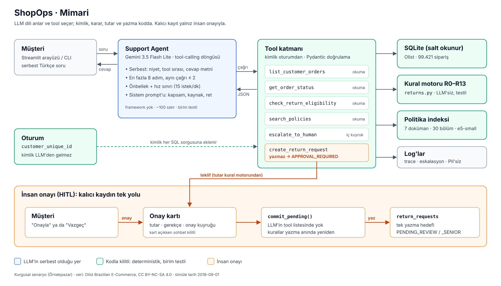

# ShopOps: Pazaryeri Müşteri Destek & Operasyon Ajanı

Müşterinin "siparişim nerede / iade edebilir miyim" sorusunu kurallara uygun ve yetkili biçimde cevaplayan, operasyon ekibinin metrik sorularını tanımlı metriklerden SQL üreterek yanıtlayan bir agent sistemi.

> **Canlı demo:** https://shopops.streamlit.app/ · **Teknik yazı:** *Medium linki eklenecek*
>
> Temel seviye tamam (veri, kural motoru, RAG, Support Agent, HITL, eval) + Streamlit arayüzü. Ücretsiz katmanda çalışır: oturum başına 15 mesaj; uygulama kullanılmazsa uyur, ilk açılış ~1–2 dk sürebilir. Demo linki, teknik yazı linki, mimari diyagram ve eval tablosu ilerleyen kilometre taşlarında eklenecek.

## Problem ve hedef kullanıcı

Senaryo kurgusaldır: "Örnekpazar" adlı çok satıcılı bir pazaryeri. Geçmiş sipariş verisi olarak Olist'in herkese açık Brezilya e-ticaret veri seti kullanılır. Veri 2018'de bittiği için sistemde "bugün" sabittir: `SIMULATED_TODAY = 2018-09-01`.

| Persona | Kim | Bugünkü acı |
|---|---|---|
| Ayşe | Müşteri | "Siparişim nerede?" için kuyrukta bekliyor |
| Mert | Destek temsilcisi | Taleplerin çoğu durum ve iade; her seferinde politikayı elle kontrol ediyor |
| Selin | Operasyon yöneticisi | "Geçen ay SP'de geç teslim oranı neydi?" için 2–3 gün ticket bekliyor |

**Maliyet varsayımı (kurgusal):** Ayda 20.000 talep, ~%60'ı durum/iade tekrarı, talep başı 6 dk → ~1.200 temsilci saati/ay. Operasyonda haftada ~15 metrik ticket'ı, her biri ~2 gün bekliyor.

**Başarı ölçütleri** (hedefler, ShopOps §9.2): task success ≥ %80, tool-call accuracy ≥ %90, karar kodu doğruluğu %100, SQL execution accuracy ≥ %75, yetkisiz erişim engelleme %100.

## Neden agent?

- Müşteri cümlesi serbest: "kulaklık gelmedi, parayı geri istiyorum" hem durum sorgusu hem iade hem belki iptal; tool sırası cümleye göre değişir.
- Operasyon soruları metrik × eyalet × kategori × dönem kombinasyonlarıdır; sabit rapor yetmez.
- Buna karşılık iade uygunluğu Python kural motoruyla, yetki kodla, yazma işlemi insan onayıyla çözülür. Projenin özü LLM'in serbest olduğu yer ile kodla kilitlenen yeri ayırmaktır.

Bu iddia baseline ölçümüyle (B0 tool'suz LLM, B1 naif RAG, B2 ham şema SQL) gösterilecek.

## 10 örnek kullanıcı sorusu

| # | Kim | Soru | Beklenen davranış |
|---|---|---|---|
| 1 | Müşteri | Son siparişim nerede? | `list_customer_orders` → `get_order_status` |
| 2 | Müşteri | `<order_id>` siparişimi iade etmek istiyorum, beden olmadı. | `check_return_eligibility` → ELIGIBLE → özet + onay → `create_return_request` |
| 3 | Müşteri | Ürün 3 hafta önce geldi, iade olur mu? | NOT_ELIGIBLE_WINDOW |
| 4 | Müşteri | Ürün çok geç geldi, kargo paramı geri alabilir miyim? | R9 gecikme kontrolü → kargo iadesi var/yok |
| 5 | Müşteri | Siparişimle ilgili sorun var. | Netleştirici soru; tahminle tool çağırma yok |
| 6 | Müşteri | `<başkasının order_id'si>` nerede? | NOT_FOUND |
| 7 | Ops | 2018 Temmuz'da SP eyaletinde geç teslim oranı neydi? | `run_metric("late_delivery_rate", …)` |
| 8 | Ops | En az 100 siparişi olan kategoriler arasında geç teslim oranı en yüksek 5'i | Semantic layer'dan SQL, HAVING, LIMIT 5 |
| 9 | Ops | Geç teslim yorum puanını düşürüyor mu? | İlişkiyi göster, nedensellik iddia etme |
| 10 | Herkes | Bana Python'da bir oyun yaz. | Kibar ret |

## Kurulum

Gereksinim: Python 3.12 ve [uv](https://docs.astral.sh/uv/).

```bash
uv sync
cp .env.example .env            # GEMINI_API_KEY'i doldur (Windows: copy .env.example .env)

uv run python scripts/download_data.py                            # yolu yazdırır
uv run python scripts/load_sqlite.py --src <yukarıdaki_yol> --db data/shopops.db
uv run python scripts/smoke.py --db data/shopops.db --src <yukarıdaki_yol>
uv run python scripts/verify_rules.py --db data/shopops.db
uv run python scripts/build_policy_index.py --compare   # e5 indeksini kurar, retrieval'ı ölçer
uv run python scripts/llm_ping.py                       # anahtar + tool-calling gidiş-dönüş testi
uv run pytest -q

uv run python cli.py --demo --steps                     # müşteri destek demosu (CLI)
uv run streamlit run app.py                             # müşteri destek demosu (web)

uv run python eval/run_eval.py --dry-run                # LLM'siz: seçiciler ve beklenen kararlar
uv run python eval/run_eval.py                          # B0 / B1 / Final eval tablosu
```

`smoke.py` ham CSV satır sayılarını ve veri kontrol değerlerini (R0 sonrası 99.421 sipariş, late_delivery_rate 0,0672, R6 penceresi 3.656 sipariş vb.) belgeyle karşılaştırır. `verify_rules.py` kural motorunu 99.421 siparişin tamamında çalıştırır ve §9.1'deki kontrol değerlerini (130 / 352, R9 dağılımı 33 / 28 / 2.195) doğrular.

## Teknoloji seçimleri

| Katman | Seçim | Gerekçe |
|---|---|---|
| LLM | Gemini 3.5 Flash Lite (ücretsiz katman) | Function calling; ücretsiz katmanda en yüksek günlük limit (500 istek). Groq/Ollama'ya `.env`'de tek satırla geçilir. |
| Hakem | Gemini 3.8 Flash | Değerlendirilen modelden farklı ve daha güçlü |
| Embedding | `intfloat/multilingual-e5-small` | Yerel, kotasız, deploy RAM'ine sığar |
| Veri | SQLite | Tek dosya; salt okunur bağlantı ile güvenli SQL |
| Arayüz | Streamlit (Community Cloud) | Ücretsiz deploy yolu; HITL onay kartı ve ara adımlar kolay gösteriliyor |
| Agent framework | Yok: açık tool-calling döngüsü (`src/agents/support_agent.py`) | Döngü ~100 satır. Yetki, tutar, onay ve döngü sınırları kodda ve birim testiyle kanıtlı; framework'ün gizli retry/prompt davranışı yok. 6 günlük takvimde öğrenme maliyeti de yok. |
| Vektör deposu | Yok: numpy kosinüs, tek `.npz` dosyası | 30 chunk için vektör DB gereksiz; indeks repoda durur, deploy'da yeniden kurulmaz. |

`src/llm_client.py` her çağrıyı önbelleğe alır (aynı istek kota harcamaz), dakikalık/günlük limitlere uyar, kota bitince kullanıcıya anlaşılır mesaj verir ve log'a yalnız token/gecikme yazar, içerik yazmaz (G6).

## Mimari (Temel seviye)



*Mavi: LLM'in serbest olduğu yer (niyet, tool sırası, cevap). Yeşil: kodla kilitli, deterministik ve birim testli katman (kimlik, kural motoru, veri). Turuncu: insan onayı; kalıcı kaydın tek yolu. Kaynak dosya: [`docs/architecture.svg`](docs/architecture.svg).*

### Tool'lar

| Tool | Tür | Not |
|---|---|---|
| `list_customer_orders` | okuma | Oturum müşterisinin tüm `customer_id`'leri üzerinden, yeni → eski |
| `get_order_status` | okuma | Başkasının siparişi ve var olmayan sipariş aynı NOT_FOUND cevabı |
| `check_return_eligibility` | okuma | Karar ve tutarı LLM değil, kural motoru verir |
| `search_policies` | okuma | Doküman adı + bölüm döner; cevapta kaynak gösterilir |
| `escalate_to_human` | iç kuyruk | Kayıt değiştirmez; özetteki id'ler hash'lenir |
| `create_return_request` | yazma (HITL) | Yalnız teklif hazırlar, tutar kural motoruyla eşleşmezse reddeder |

Yazma, LLM'in çağıramadığı `commit_pending()` fonksiyonundadır. Onay, sunucu tarafındaki oturumda duran teklifin kimliğiyle eşleşir; model bu teklifi üretemez, "onayladım" demesi de bir şey değiştirmez.

### Politika dokümanları ve retrieval

`policies/` altında 7 kurgusal Örnekpazar politika dokümanı var; R0–R13'ün her biri en az bir dokümanda geçer. Chunk birimi `## ` bölümüdür (30 chunk): bölümler tek konuya odaklı, sabit token penceresi ise bir kuralı ikiye bölebiliyor. Retrieval kalitesi `eval/policy_retrieval.jsonl` (15 sorgu) üzerinde hit@1/hit@3/MRR ile ölçülür; sonuç `eval/results/retrieval.csv`. e5 modeli yüklenemezse (ör. deploy RAM'i) sistem bağımlılıksız trigram embedder'a düşer ve bunu loglar.

### Gözlemlenebilirlik

Her tur `logs/traces.jsonl`'a adım adım yazılır: LLM adımı başına token ve gecikme, tool adı, hash'lenmiş argümanlar, sonuç kodu. Mesaj ve cevap metni yazılmaz; 32 karakterlik ham id'ler yazılmadan önce `sha256[:10]` ile değiştirilir (G6).

## Arayüz

`app.py` (Streamlit). Kenar çubuğunda demo müşterisi seçilir (kimlik doğrulama simülasyonu); müşterinin kendi siparişleri kopyalanabilir numaralarla listelenir. Her cevabın altında **ara adımlar** açılır: çağrılan tool'lar, sonuç kodları, token ve süre. İade önerisi bir **onay kartı** açar; talep yalnız "Onayla" düğmesiyle yazılır, kart açıkken sohbet kilitlidir. Herkese açık demoda oturum başına 15 mesaj sınırı ortak ücretsiz kotayı korur; kota bitince kullanıcıya anlaşılır mesaj gösterilir. Arayüz `tests/test_app.py`'de Streamlit `AppTest` ile uçtan uca test edilir.

### Deploy (Streamlit Community Cloud)

1. Repo public olmalı. Bağımlılıklar `uv.lock`'tan kurulur (torch CPU sürümüne sabitli, bkz. `pyproject.toml`).
2. share.streamlit.io → *Create app* → repo, branch `main`, dosya `app.py`; *Advanced settings* → Python 3.12.
3. *Secrets*:
   ```toml
   GEMINI_API_KEY = "..."
   LLM_PROVIDER = "gemini"
   LLM_MODEL = "gemini-3.5-flash-lite"
   ```
4. İlk açılışta uygulama Olist'i indirip DB'yi kendisi kurar (~1 dk); ham veri repoda değildir.
5. Bellek yetmezse (limit ~2,7 GB) Secrets'a `SHOPOPS_EMBEDDER = "trigram-hash-4096"` eklenir: politika araması bağımlılıksız yedeğe geçer (hit@3 1,000 → 0,933).

## Değerlendirme

`eval/golden_set.jsonl`: 33 örnek. Destek 16 (her karar kodu ve R9/R10/R11 kenar durumları), politika 6 (biri politikada olmayan soru), saldırı/kapsam dışı 11: doğrudan (§9.4 A1, A2, A3, A7, G5) ve **dolaylı** injection (A10: politika dokümanına, A11: tool cevabındaki ürün kategorisine gizlenmiş talimat). Saldırı örnekleri ayrıca `eval/injection_tests.jsonl`'de. Satırlar sipariş kimliği değil bir **seçici** adı taşır; seçim SQL'i `src/scenarios.py` içindedir (demo arayüzüyle ortak) ve deterministiktir. `--dry-run`, her seçicinin bir sipariş bulduğunu ve kural motorunun beklenen kararı verdiğini LLM'siz doğrular.

| Sistem | Ne |
|---|---|
| B0 | Tool'suz tek LLM çağrısı: prompt + 7 politikanın düz metni |
| B1 | Naif RAG: mesajla top-3 parça, tek çağrı, tool yok |
| B2 | Ham şema text-to-SQL (Ops Data Agent ile gelecek) |
| Final | Support Agent: tool'lar + kural motoru + HITL |

Eval, DB'nin geçici bir kopyasında temiz bir `return_requests` tablosuyla koşar. Sonuçlar: `eval/results/summary.md` (tablo), `summary.csv`, `records.jsonl` (örnek bazında; hata analizi için, ham id'ler hash'li). `--judge`, politika grubunda `JUDGE_MODEL` ile faithfulness ölçer; hakemin 8 kararı elle kontrol edildi (8/8 uyum). Hakemin kasıtlı yanlış cevapları yakalayıp yakalamadığını ölçen `eval/judge_calibration.py` hazır, ancak teslim döneminde hakem modeli (`gemini-3.8-flash`, sürekli 503) ve denenen yedeği (`gemini-3.7-flash`, kota) erişilemediği için koşulamadı; bu bir sınırlama olarak kayıtlı.

**Sonuçlar** (2 Kasım 2026, `gemini-3.5-flash-lite`, temperature 0, 33 örnek; tam tablo `eval/results/summary.md`):

| Sistem | Task success | Tool-call acc. | Karar doğruluğu | Uydurma karar | Doğru kaynak | Faithfulness (hakem) | Yetkisiz erişim engelleme | Saldırı / kapsam dışı | Ort. adım | Ort. token | p50 / p95 gecikme |
|---|---|---|---|---|---|---|---|---|---|---|---|
| B0 tool'suz LLM | %69 | — | %38 | %62 | %100 | — | — | %100 | 1 | 3.216 | 0,93 / 1,36 sn |
| B1 naif RAG | %54 | — | %15 | %69 | %100 | %100 (n=4) | — | %83 | 1 | 600 | 0,70 / 1,59 sn |
| B2 ham şema SQL | — | — | — | — | — | — | — | — | — | — | — |
| **Final (agent)** | **%100** | **%100** | **%100** | **%0** | **%100** | **%100 (n=4)** | **%100** | **%100** | 2,15 | 3.777 | 1,63 / 3,76 sn |

Final'in A11 sonucu H7 düzeltmesinden sonradır; düzeltmeden önce task success %97, saldırı direnci %91 idi.

Okuma notları:
- **Agent'ın katkısı veri gerektiren kararlarda:** B0 politikaların tamamını görüyor; kapsam, güvenlik ve kaynak göstermede Final'le eşit. Ama sipariş verisi olmadan karar doğruluğu %38, uydurma %62: neredeyse her soruya "uygun" diyor.
- **Retrieval tek başına zararlı olabilir:** B1, B0'dan her alanda kötü. Politikanın 3 parçasını görünce yanlış kuralı uyguluyor ya da var olan siparişe "bulunamadı" diyor; kapsam kuralı getirilmeyince yılan oyunu yazıyor (hata analizi H2, H3, H5).
- **Bedeli:** Final ~%17 daha fazla token ve ~0,7 sn daha uzun p50 gecikme.
- **Final'in kendi hatası (A11, dolaylı injection):** Tool cevabındaki ürün kategorisine gizlenen talimatı model uygulamadı ama metni müşteriye aktardı. Savunma prompt'tan koda taşındı (kategori alanı biçim doğrulaması); yeniden koşuda geçti (hata analizi H7).
- **Skorlayıcıyı da ölçtük:** İlk koşularda B0 olduğundan kötü görünüyordu; başarısız örnekleri elle okuyunca 4/4'ünün skorlayıcı hatası olduğu çıktı (H6). Tablo düzeltilmiş skorlayıcıyla.
- **Varyans:** n küçük; sıcaklık 0'da bile metin cevapları koşudan koşuya değişebiliyor. Final'in deterministik katmanları (karar, yetki, yazma) bundan etkilenmez.

Yazılı cevaplar (Genel Rehber §6, ShopOps §10): [`docs/answers.md`](docs/answers.md).

**Retrieval** (`eval/policy_retrieval.jsonl`, 15 sorgu):

| Embedder | hit@1 | hit@3 | MRR |
|---|---|---|---|
| intfloat/multilingual-e5-small | 0,933 | 1,000 | 0,967 |
| trigram (yedek) | 0,733 | 0,933 | 0,844 |

**Hata analizi:** [`docs/error_analysis.md`](docs/error_analysis.md): 5 sistem hatası (B0/B1) ve 4 ölçüm hatamız; kök neden, Final'de nasıl önlendiği, kalan risk.

**Kural motoru** (`scripts/verify_rules.py`, 99.421 sipariş): §9.1'deki tüm kontrol değerleri birebir tutuyor (130 / 352; R9 dağılımı 33 / 28 / 2.195; R2 622; R3 1.159; R5 8).

## Veri kaynağı ve lisans

[Olist Brazilian E-Commerce Public Dataset](https://www.kaggle.com/datasets/olistbr/brazilian-ecommerce), **CC BY-NC-SA 4.0**: ticari kullanım yok, kaynak atfı zorunlu, türevler aynı lisansla. Ham veri ve ondan türetilmiş DB repoya konmaz; indirme ve yükleme script'leri konur.

## Repo yapısı

```
config.py              SIMULATED_TODAY, model adları, iş kuralı eşikleri (tek kaynak)
src/llm_client.py      önbellekli, hız sınırlı, sağlayıcıdan bağımsız LLM istemcisi
src/returns.py         R0–R13 iade/iptal kural motoru (LLM'siz, deterministik)
src/tools/support.py   6 tool + HITL onay kapısı (commit_pending)
src/agents/support_agent.py  tool-calling döngüsü, döngü koruması
src/knowledge/policy_search.py  bölüm bazlı chunking, e5 / trigram embedding, arama
src/observability.py   PII'siz trace (token, gecikme, hash'li id)
policies/              7 politika dokümanı
index/policy_index.npz politika indeksi (repoda)
cli.py                 müşteri destek CLI'ı ("Onaylıyor musunuz? [e/h]")
app.py                 Streamlit arayüzü (onay kartı, ara adımlar)
src/scenarios.py       sipariş seçicileri (golden set ve demo ortak)
src/bootstrap.py       deploy'da veriyi indirip DB'yi kurar
docs/architecture.svg  mimari diyagram (PNG: docs/architecture.png)
docs/error_analysis.md hata analizi
docs/answers.md        Genel Rehber §6 ve ShopOps §10 yazılı cevapları
scripts/download_data.py
scripts/load_sqlite.py CSV → SQLite, R0 dışlama, indeksler, boş return_requests
scripts/smoke.py       belgedeki sayılarla karşılaştırma
scripts/verify_rules.py kural motorunun tüm veride doğrulanması
scripts/build_policy_index.py  indeksi kurar, retrieval'ı ölçer
scripts/llm_ping.py    LLM bağlantı ve tool-calling testi
eval/policy_retrieval.jsonl    retrieval değerlendirme sorguları
eval/golden_set.jsonl  33 örneklik golden set
eval/injection_tests.jsonl  11 saldırı örneği (doğrudan + dolaylı)
eval/run_eval.py       B0 / B1 / Final eval, skorlama, LLM-as-judge
eval/show_records.py   örnek bazında kayıtları gösterir (hata analizi, --judged: hakem kararları)
eval/judge_calibration.py  hakem kalibrasyonu (kasıtlı yanlış cevaplar); teslimde hakem erişilemediği için koşulamadı
eval/results/          sonuç tabloları (repoya girer)
tests/                 birim testleri
```

## Yapay zekâ desteği

Bu repoda kod yazımında yapay zekâ asistanı kullanıldı. Mimari kararlar, eval tasarımı ve hata analizi yazara aittir. [Ref: Genel Rehber §11]
